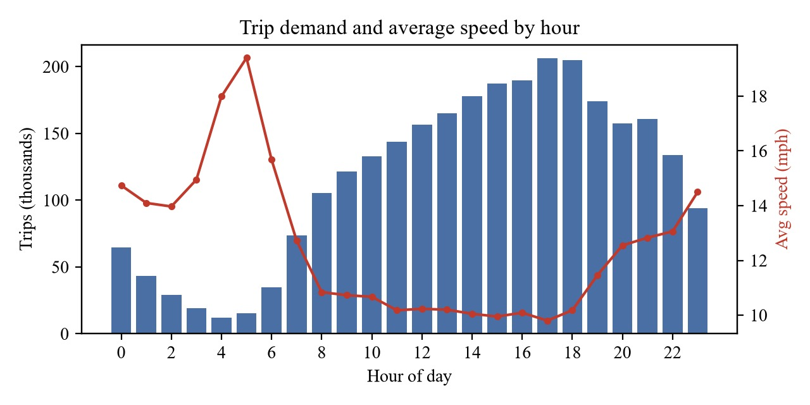
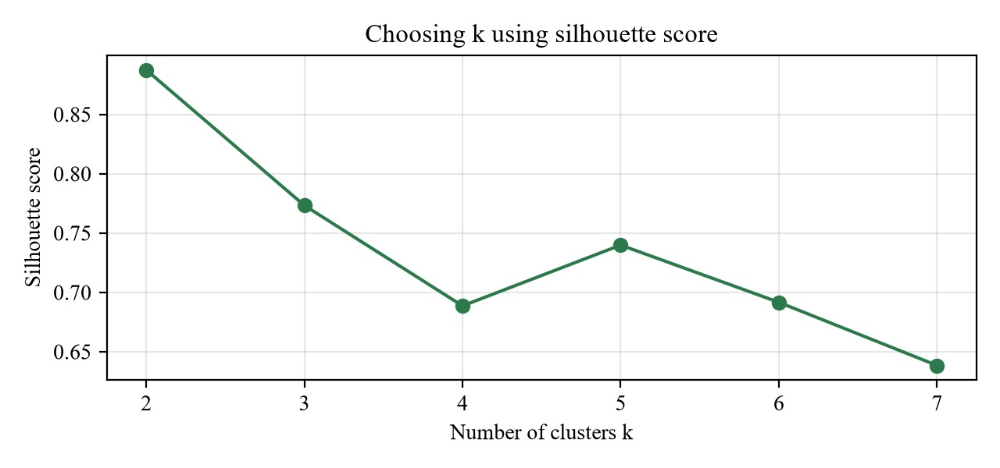
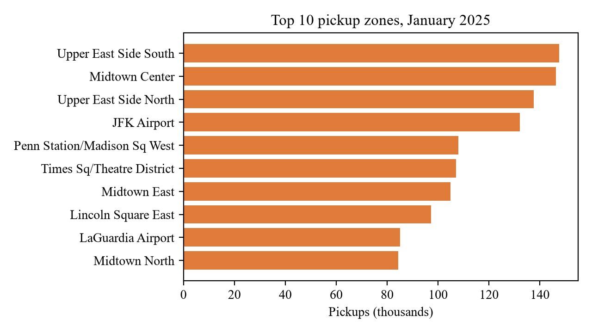
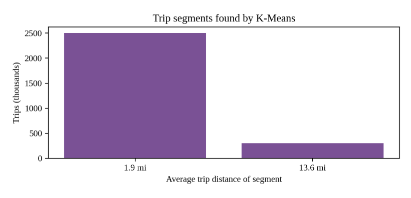
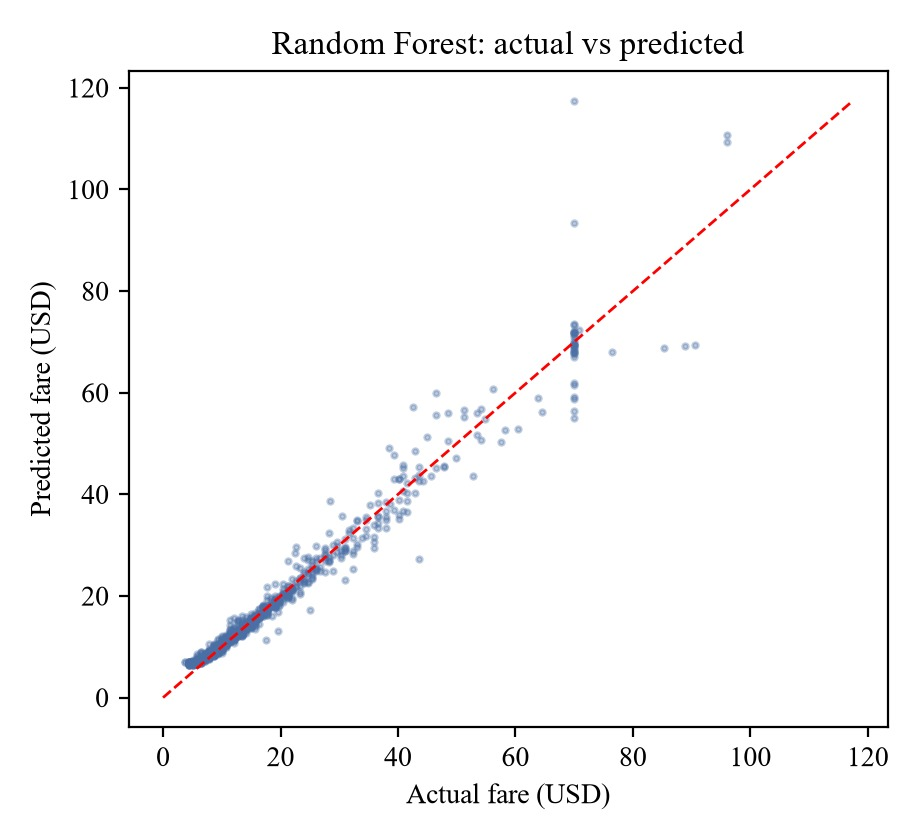

# Taxi Trip Analytics

A local Apache Spark application for analyzing NYC yellow taxi trips from January 2025. It produces summary CSVs, trip clusters, and fare-model results.

## Requirements

- JDK 17
- Maven 3.9 or newer
- Python 3.9 or newer only if generating charts

Spark 3.5.3 is configured in `pom.xml`. Use JDK 17; the Maven launcher passes Spark's required JVM module options to the forked Java process.

## Run with Docker

Only Docker is required. The image compiles the app, then runs the Spark analysis and chart generation in one step:

```powershell
docker build -t taxi-trip-analytics .
docker run --rm -v "${PWD}\out:/app/out" taxi-trip-analytics
```

Results, charts, and `out/index.html` appear in the local `out/` folder. To give Spark more memory, add `-e JAVA_OPTS=-Xmx6g` to `docker run`.

## Run the analysis

From this directory, run:

```powershell
mvn clean compile exec:exec@run-spark
```

Make sure Maven is using JDK 17. The first run downloads Spark and its dependencies and may take several minutes. The input files are included under `data/`.

The program writes CSV results to `out/`.

## Generate charts (optional)

After the Java analysis completes:

```powershell
python -m pip install -r requirements.txt
python charts_real.py
```

Chart images are written to `out/` as well.

Open `out/index.html` in a browser to view all generated charts together.

## Results & Visualizations

The project analyzes approximately 3.5 million NYC yellow taxi trip records from January 2025 using Apache Spark 3.5.3. The analysis explores hourly demand, pickup hotspots, trip segmentation, and machine learning-based fare prediction.

### 1. Hourly Trip Demand & Average Speed



Compares the number of taxi trips with average travel speed for each hour of the day. This helps identify peak-demand periods and understand how traffic conditions vary throughout the day.

### 2. Selecting the Optimal Number of Clusters



Compares silhouette scores for different values of K in K-Means clustering. The highest score occurs at **K = 2 (approximately 0.89)**, supporting the selection of two trip segments.

### 3. Top 10 Pickup Zones



Highlights the busiest taxi pickup zones in January 2025, including major Manhattan locations and JFK Airport. This reveals geographical patterns in taxi demand.

### 4. Trip Segmentation Using K-Means



Shows the volume and average trip distance of the two clusters. The results distinguish a large group of shorter city trips from a smaller group of longer trips.

### 5. Taxi Fare Prediction



Compares actual taxi fares with fares predicted by the Random Forest regression model. Points closer to the diagonal reference line indicate more accurate predictions.

### Key Results

| Analysis | Result |
|---|---|
| Raw trip records | 3,475,226 |
| Records after cleaning | 2,803,497 |
| Selected K-Means clusters | 2 |
| Best silhouette score | Approximately 0.89 |
| Linear Regression R² | 0.924 |
| Linear Regression RMSE | $4.61 |
| Random Forest MAE | $1.52 |

These results demonstrate how distributed data processing and machine learning can be applied to real-world urban transportation data.

**Explore the complete dashboard:** Run the project and open `out/index.html` in your browser.
